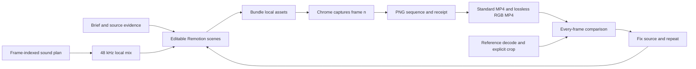

# Implementation and acceptance

## Scope

Rebuild the visible motion artwork in four supplied files as editable code;
preserve native frame rate and frame count; rebuild the sound. The Remotion
guide is inspiration. The user explicitly rejected an approximate recreation.

There are two workflows sharing the same renderer: reference reconstruction
and original authoring from a product repo. A reference benchmark does not
prove that a repo-only authoring workflow works, and a good original film does
not prove pixel parity with a reference.

## Measured targets

| Project | Target size | FPS | Frames | Artwork duration |
| --- | --- | --- | --- | --- |
| Alconost localization | 1080 × 1920 | 25 | 490 | 19.600 s |
| Minimalist / priceless | 1080 × 1920 | 60 | 535 | 8.9167 s |
| Creators Studio | 556 × 314 cropped panel | 48 | 522 | 10.875 s |
| Glassy phone | 888 × 1920 | 24 | 364 | 15.1667 s |

Total: **1,911 decoded artwork frames**. These durations come from the video
frames, not the longer audio/container durations. Raw stream metadata and every
presentation timestamp are in `analysis/inventory.json`.

Creators Studio uses `(x=80, y=318, width=556, height=314)` in the downloaded
720 × 1280 split-screen file. This records the full visible upper panel bounds.
Its rounded corners retain a few wrapper pixels; the native uncropped artwork
is unavailable. No lower Re-make panel is treated as the target. The crop is an
explicit working interpretation and can be changed if the user specifies another
artwork boundary; it is never optimized to hide mismatches.

## Engine

`scripts/render.mjs` uses supported `@remotion/bundler` and `@remotion/renderer`
APIs: `bundle`, `selectComposition`, `renderFrames`, `renderStill` and
`stitchFramesToVideo`. It retains captured PNGs instead of recording real-time
playback. Each frame must be a pure function of its index and local assets.

Each attempt has a unique directory, so stale tail frames cannot enter a later
export. A receipt records input props, source and dependency hashes, browser
version, video metadata, captured image hashes and stage failures. A fresh
browser re-captures first, middle and last frames out of order and compares
decoded pixels. This is a sampled determinism check, not a proof for every frame.

Chrome capture is now working after network access was enabled. Playwright
also reaches Studio with the installed Chrome executable. `EngineCheck` passed
PNG capture, fresh-browser repeatability, both encodes and metadata checks.
All four authored reconstruction drafts now have full exports and receipts.

The pipeline checks input consistency at the bundle boundary and records every
bundle file hash. Captures use that frozen bundle, so subsequent Studio edits
cannot alter the running export. The completed bundle is checked again. Remotion's
capture-assets cleanup is held through repeat captures and stitching; otherwise
its asynchronous cleanup could remove the audio/stitching workspace too soon.

The renderer now pins `swangle` software GL in both capture browsers. The phone
initially failed repeatability on 54 one-value edge differences; its full rerender
passed without introducing a tolerance. A scaled transparent logo in the original
repo film also produced one-value differences. Giving it an integer 2× native size
resolved that case. Repeatability remains a required, sampled check.

## Strict visual gate

The benchmark streams decoded RGB24 buffers with FFmpeg and compares their
actual bytes. SHA-256 is an audit identifier only. It also checks dimensions, frame
rate, all rational presentation times relative to their first displayed frame, and exact
decoded frame counts. The fixed container-origin subtraction is recorded in the
report; there is no content-offset search or time warping. Missing trailing
frames fail even when every compared frame matches.

The renderer produces `master.rgb.mp4` with `libx264rgb -crf 0` because ordinary
YUV420 H.264 introduces new pixel errors. A test proves that this encoding path
preserves a known RGB sequence. The standard MP4 is for playback compatibility;
the RGB master is the strict parity candidate. Exporting an MP4 alone is not a
parity pass, and the RGB master may have less player support than the delivery.

SSIM and the worst-frame reference/candidate/difference triptychs are diagnostic
only. Large empty backgrounds can hide an incorrect small object in an average
score. The acceptance report never substitutes a similarity threshold for exact
equality. `npm run parity` requires all four candidates. The latest full suite compares
all 1,911 frames and fails on pixels in every frame; dimensions, FPS, frame counts
and relative timestamps pass for all four.

Reference video files and extracted reference frame sequences stay outside
`public/` and production imports. Re-encoding a download, playing its frames,
or encoding per-frame pixels into code would not establish an editable rebuild.
The four-project suite also requires the renderer's adjacent capture receipt,
successful source-audit/capture/determinism/encode stages, matching composition
and master hash, and source/dependency provenance. These are workflow records,
not cryptographic attestation. Static source guards catch direct reference
imports/copies; a source review must still establish that the artwork is rebuilt.

## Authored drafts and remaining work

| Production | Implemented and checked | Remaining mismatch |
| --- | --- | --- |
| Alconost | Four scenes, measured cuts 125/238/388, local official logo, fitted analytic backdrop; CTA entrance corrected | Exact type, file-window details, fades, chart animation and background pixels |
| Creators | Camera/lens geometry and panel tracks; repaired false camera jump, restored tumble, corrected searchlight and outgoing-panel motion | Native extended font, grain, glow, motion blur and corner/wrapper pixels |
| Minimalist | Measured sphere/caption tracks, authored coins, smile, pendulum and projected geographic outlines; repaired smile dropout | Coin geometry/rotation, serif/brand type, pendulum entry/blur, face and globe artwork |
| Phone | Editable SVG/CSS UI, pose curves, notification turn, camera controls, route/map and closing brand | Native 3D camera/materials, wallpaper, icon trajectories, exact photo, glass and map geometry |

These are editable drafts, **not accepted 1:1 rebuilds**. Phone is currently a
2.5D implementation; it cannot be described as a recovered native 3D scene.
Missing native assets remain unresolved because the user has only the downloads.
No original video or extracted frame sequence is a production playback input.
The phone uses a provenance-recorded, isolated static photo recovery; its occluded
regions are approximated, and this does not establish an exact source asset.

The latest suite is `out/acceptance/suite.json`. It reports 490/490, 535/535,
522/522 and 364/364 mismatching frames respectively. SSIM is retained solely
to prioritize diagnostics. The RGB difference viewer now uses RGB channel gain;
an equal image produces a black error panel, verified by regression test.

Next work is precise layer/asset reconstruction and repeated transition review,
then every-frame comparison again. The sound brief now includes Brag-style
Kokoro narration matching reference speech in Alconost, Minimalist and Phone.
Creators stays music/SFX-only by the user’s explicit choice. This supersedes
the earlier no-voice instruction. Audio does not move or retime any reference picture frames.

Exact equality cannot be promised merely from a compressed download. Hidden
layers, fonts, textures, 3D models, lighting and original render settings are not
supplied. Even native assets may render differently across engines. The gate
remains exact; if it cannot be achieved, report the remaining mismatches and
cause instead of silently changing what acceptance means.

## Sound design learned from Brag

Inspected both installed Brag copies and the plugin's `references/audio.md`,
repo-inspection rubric, music cue presets and SFX analysis.

- Default music is the bundled Sascha Ende library, CC BY 4.0.
- Default SFX are bundled Kenney files, CC0.
- The agent chooses and places those files. They are not generated by AI.
- Brag's optional narration path uses Kokoro through HyperFrames; its media
  skill also documents optional providers. The latest user request enables the exact Brag local Kokoro route. No paid
  provider or speaker cloning is used.
- Beat presets are musical timing hints. They must not alter a reference's
  visual timing. Reconstructed sound follows picture, rather than moving picture
  to a new soundtrack's beats.

`scripts/audio.py` resolves local files through a hashed license ledger, converts
integer frame positions into sample positions at 48 kHz, mixes with gain/fades,
normalizes loudness in two passes and measures the result. The music/SFX mixes pass sample-count, loudness and true-peak checks. Cues were
retimed to the authored action frames. The new narration path writes independent
`bed.wav` and `voice.wav` stems, ducks music to 0.13 under speech and checks their
combined `mix.wav`. Technical checks do not constitute listening review.

## Repo-only authoring

`scripts/inspect-repo.mjs` uses ignore-aware `rg` enumeration. It gathers package
identity, public copy with file/line evidence, routes, color/font declarations
and asset paths. It excludes common secret/generated paths, does not follow
external symlinks, redacts common token/email patterns, and executes no project
scripts. It is an evidence collector, not a complete autonomous video generator.

The agent then applies `skills/motion-studio`: read the relevant source, identify
entry → action → result, choose supported claims, author a storyboard and new
Remotion scenes, reuse real product assets, build local audio, preview, render
and review. The agent is the orchestration layer; no separate LLM API service
is required. Original productions do not need external reference images or
videos. A 15-second original film is now implemented in `projects/haft-studio-launch/`,
using the adjacent Haft Studio website source, existing product imagery, logo,
brand font, theme and source-backed copy. It uses no supplied reference media
and modifies no inspected-repo files. It has a full render and passing capture/
repeatability/encode receipt; its scene frames were visually inspected. Full
listening and delivery review remain separate.

## Verified versus pending

| Item | Current evidence |
| --- | --- |
| Pinned Remotion dependencies | Working installation; lockfile retained |
| TypeScript | Source checks run with every material source revision |
| Engine tests | 19 tests pass: RGB/PTS/tail/FPS, diagnostics, source inspection, narrated stems/ducking |
| All source frames | Extraction index records each frame and timestamp/hash |
| Browser and capture | Working Chrome and Playwright; frozen-bundle receipts |
| Four artwork drafts | Registered, editable, full native-size/FPS/frame-count exports |
| Exact visual parity | **0/4; all 1,911 frames differ** |
| Sound | Brag library music/SFX rebuilt; local Kokoro narration on three references and an original Haft script; encoded levels/ASR pass; listening approval pending |
| Visual review | Scene and transition frames inspected; specific defects corrected; full approval pending |
| Listening review | Pending; numerical loudness checks are not a listening review |
| Repo-only original film | Haft Studio film exported; no reference media used |

The side-by-side player (`npm run review`, port 3211) reads references only for
review, outside production assets. It provides frame stepping, quarter/half speed
and candidate audio. It displays the actual parity failure from the suite. Its
browser playback uses delivery H.264, while the strict comparison decodes RGB
masters independently. Playwright smoke checks covered playback, stepping, the
556×314 crop and HTTP byte ranges.

## Latest sound revision

Minimalist’s ending no longer stretches short speech to fill an ASR window.
Natural pace is retained and unused time becomes silence. A regression test
checks this behavior. Phone uses the same natural policy. Haft Studio now has
original repo-based copy in `SCRIPT.md` and generated Kokoro narration over its
music/SFX. Creators remains explicitly unvoiced.

Sound-only revisions use `scripts/mux-audio.mjs`. It preserves every compressed
video packet and displayed PTS, verifies its completed parent capture and writes
a separate audio-revision receipt. The suite recursively validates the parent
evidence. This saves a new visual capture when only the sound changed, without
claiming a fresh Chrome capture or changing the picture. Latest per-production
artifact paths are in `projects/<slug>/delivery.json`.

Encoded MP4 audio (not only WAV stems) passes loudness/peak checks for all five
films. ASR of the delivered narrated benchmarks recovers their intended words
with normal brand-name homophone/spelling variants. This is not a listening
review. The strict visual gate remains independent and unapproved.

## Latest reconstruction tightening

See `docs/EXACT_RECONSTRUCTION.md`. Exact acceptance now uses direct decoded RGB
byte comparison and integer-PTS/rational-time equality. The CSV covers every
native frame, including absent tails. New regressions prove audit-hash equality
cannot hide a different pixel and a one-microsecond relative drift fails.
The live review code rejects stale candidate reports and exposes the current
frame’s master result plus its full audit CSV.

A fixed-region temporal audit identified the old static Alconost card at frames
51–99. Its measured outline pose now drives the card shake; that omission is no
longer flagged. The low-opacity exit remains unresolved. Minimalist’s angled
string now has the measured brighter core/halo, a top anchor and correct
circle-surface attachment; native and preview-size samples were inspected.
These repairs do not constitute whole-film parity.

Close speech passages now share one ducking envelope, with a smooth dB-domain
release and no brief recoveries between phrases. Alconost’s final TTS input
explicitly says “Alconost dot com”. Creators now has a new licensed rhythmic
bed, authored stereo swishes with peaks at measured movement frames, and camera/
lens accents. It remains unvoiced. Listening approval stays separate.

The current review player waits for both reference and candidate media to load and
seek before repainting a paused comparison. Browser checks covered project switches
across all four references and the 535-row Minimalist audit download without errors.
The latest suite compares 1,911 frames; relative timestamps match throughout, but
all 1,911 frames still differ in RGB pixels. Exact visual acceptance remains 0/4.

## Original product-film expansion — 31 October 2026

The requested six-library study is recorded, in order, in
[research/GRAPHICS.md](research/GRAPHICS.md). Six version-pinned visual skills
and the existing motion-studio router are registered for use from other repos.
Their capability inventories describe documented APIs separately from actual
pilot coverage. The shared adapters use p5, Thinking Orbs, Rough.js, Anime.js and
PixiJS under Remotion's frame clock; p5.brush paints a seeded build-time asset.
No independent ticker or live product mutation drives a film.

Three authored Schoolbooks productions cover a product brag (18 s, landscape),
a feature guide (24 s, landscape) and a pain-point social clip (15 s, portrait).
They have local Kokoro narration, licensed music/SFX, held ducking, source-backed
claims, explicit fictional demo data and separate editable compositions. The
feature guide traces the actual review/confirmation/personal-task code and
preserves the invoice amount after confirmation. The launch uses an existing
product screenshot. The social pain is explicitly an inference from code.

`npm run test:capabilities` passes seven actual-library checks, including all
nine Orbs geometry modes and actual canvas reverse-seek comparisons. All 19
engine regression tests and TypeScript checks pass. Each film passes complete
Chrome capture, fresh-browser first/middle/last repeat checks and both encodes.
`npm run test:productions` checks exact intended frame counts, dimensions/rates,
source hashes, soundtrack/cue windows and encoded audio levels, and creates
posters, captions, decoded boards and delivery manifests. Actual reports are
[capabilities](../analysis/capabilities/report.json) and
[productions](../analysis/productions/report.json).

Scene/transition captures and decoded export boards were visually inspected.
The separate playback report records full **muted** browser playback. Subjective
auditory review remains pending; meters and playback completion do not establish
pronunciation or music balance. The review player is served by
`npm run productions` at http://localhost:3213. Each production's REVIEW.md
records the actual review scope. Source/media provenance, music attribution,
third-party notices and a share-copy file accompany the delivery.

This expansion does not change reconstruction acceptance. All four original
reference targets remain unaccepted; these three original films are separate
productions and do not count toward 1:1 reference parity.

### Feature guide UI fidelity correction

The initial simplified Findings panel is rejected as a product guide. The guide
now captures the actual existing Schoolbooks production frontend with isolated
API fixtures from its own E2E test, completed with the real settings contract
and exact backend proposal template. No product markup, CSS, native labels,
layout or control state is recreated. Source/build/compiled-asset hashes,
viewport and actual DOM targets are retained in the capture provenance.

The native workflow also corrects the post-confirmation sequence: an actioned
finding leaves Needs attention; History contains Open follow-up task. Narration
and cursor choreography include that real tab change. Instructions and progress
sit outside a native 1600 × 900 product viewport at integer 1× placement.

Guide productions now require uiEvidence. The normal export verifier invokes
verify-native-ui.mjs to compare actual RGB bytes in five unobscured native UI
regions against the actual-app screenshot assets. Missing evidence, resizing
and a one-channel pixel change are regression-tested by
`npm run test:native-ui`. This is a guide-specific UI check; it is separate from
the full reference-artwork parity gate and does not certify backend behavior.
The guide, repo-film skill and AGENTS.md prohibit invented UI as a guide fallback.

### Demo cursor and click feedback

The cursor layer is now separate from Schoolbooks branding. Studio-authored
arrow/hand/touch vectors have explicit hotspots and visible SVG overflow.
Position, tilt and click scale share the hotspot origin. The feature guide
uses measured inner-control targets, keeps the pointer above callouts, fades
idle holds and uses a hand only inside the final link's real bounds. Click
ripples stay at the fixed event point and trim at shot boundaries. The three
visual click frames match the existing click SFX; the final hover adds none.

The new motion-cursors skill is registered alongside the existing seven skills.
[Official-image research](research/cursors/RESEARCH.md) includes original Screen
Studio/Tella images and timestamped stills from Tella's published demo. These
are references outside public; the vectors used in production are authored here.
`npm run test:cursors` checks actual browser hotspot projection through press
and tilt, visible feedback, reverse-seek RGB equality and SFX-frame agreement.
Scene snapshots include click-adjacent frames and native-size detail crops.
