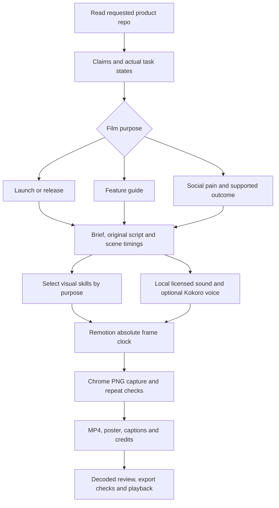

# Six graphics libraries, one film clock

Studied in the requested order on 31 October 2026. These are independent visual
libraries, not six competing renderers. Remotion owns dimensions, frame index,
scene boundaries, media, Chrome capture and MP4 output. The six techniques below
are selected for what a scene needs to communicate.

The official documentation and author source are linked in each capability map.
The pinned packages were also inspected: documentation describes what can be
built; installed source/types establish the signatures this workspace can run.
[Machine-readable inventory](graphics-libraries.json) records versions, licenses,
82 capability families and the source URLs. This is a practical feature inventory,
not a claim to reproduce every upstream API or certify every feature.

## 1. p5.brush — physical marks and painted emphasis

[Official project](https://github.com/acamposuribe/p5.brush),
[standalone contract](https://github.com/acamposuribe/p5.brush/blob/main/docs/standalone.md),
[studio skill](../../skills/motion-p5-brush/SKILL.md),
[14-family map](../../skills/motion-p5-brush/references/capabilities.md).

Version 3.0.0 has distinct p5 and standalone builds. The standalone build owns a
WebGL2 canvas and exposes its own render, clear, seed and transform lifecycle.
The p5 integration uses a p5 WEBGL sketch. Mixing examples from these builds is
an easy source of wrong coordinates and missing initialization.

The useful surface extends beyond brush lines: dry-media and marker tips,
custom and image tips, pressure/weight, watercolor fills and layered washes,
hatching, mass placement, fields, clipping, polygons, plots and positions. The
map records coordinate/angle differences and asynchronous image loading. Brush
scaling is setup state, not something to compound on every captured frame.

The social film uses **actual seeded standalone marker output** baked locally,
then tinted through its alpha and revealed by Remotion. That is build-time
library use. Two fresh Chrome pages produce identical decoded pixels; the PNG,
seed, generator hash and provenance remain editable/auditable. Watercolor,
custom tips and fields are documented recipes, not exercised pilot features.

## 2. p5.js — procedural explanatory drawing

[Official tutorials](https://p5js.org/tutorials/),
[reference](https://p5js.org/reference/),
[studio skill](../../skills/motion-p5/SKILL.md),
[14-family map](../../skills/motion-p5/references/capabilities.md).

The tutorial sequence supplies foundations in shapes, curves, coordinates,
color, typography, images, interaction, data, sound and WebGL. More advanced
surfaces include shaders, framebuffers, lighting/materials and layered rendering.
The map includes accessibility, local asset readiness and WebGL performance.
Version 2.3.4 ships its own types; old p5 v1 type packages are not installed.

Film integration uses instance mode, a stopped loop, fixed pixel density, seeds,
a complete redraw and an awaited `redraw()`. `frameCount`, `millis()`, mouse input
and the autonomous draw loop cannot define video time. The guide uses p5 for a
procedural progress track; the browser test checks real canvas pixels after
15 → 45 → 89 → 0 → 15 seeking. Same-time bytes match and different times differ.
Shader/media/input examples require their own readiness and determinism checks
when introduced. p5 is LGPL-2.1; its notice is retained separately from the MIT
libraries. The package is unmodified.

## 3. Thinking Orbs — meaningful agent-state feedback

[Official repository](https://github.com/Jakubantalik/thinking-orbs),
[pure engine](https://github.com/Jakubantalik/thinking-orbs/blob/main/src/engine/index.ts),
[studio skill](../../skills/motion-thinking-orbs/SKILL.md),
[14-family map and published additions](../../skills/motion-thinking-orbs/references/capabilities.md).

This is a Canvas2D dotted geometry engine. Its nine states are working/orbits,
searching/globe, solving/rubik, listening/wave, connecting/web, weaving/braid,
composing/ribbon, breathing/ring and shaping/morph. State choice should explain
the depicted activity rather than imply an unsupported live process.

The React component uses wall-clock animation and observers. Its pause flag
is not a seek API. The supported `thinking-orbs/engine` exports let us resolve
preset tuning, evaluate geometry at absolute seconds and paint a fixed theme.
All nine states are exercised at 20, 32 and 64 sizes for finite geometry,
depth order and seek repeatability. The launch uses the connecting state beside
source-backed product material; the canvas test checks its actual painted output.

Published 0.3.2 includes features beyond the main-branch README inspected during
research: interpolated 32 sizing, tint, density, dot radius, custom frame geometry
and pointer gravity. Installed types/source establish that scope. Pointer gravity
is an interactive raster effect with accessibility guards; it is not appropriate
as a live OS-pointer dependency during film capture.

## 4. Rough.js — instructional marks with stable geometry

[Official site](https://roughjs.com/),
[author API/options wiki](https://github.com/rough-stuff/rough/wiki),
[studio skill](../../skills/motion-roughjs/SKILL.md),
[14-family map](../../skills/motion-roughjs/references/capabilities.md).

Version 4.6.6 supplies lines, rectangles, ellipses/circles, paths, arcs, curves,
linear paths, polygons and multiple sketched fill styles through Canvas/SVG or
pure generator output. Options control roughness, bowing, stroke, fill/hatching,
curve fitting, vertex preservation and deterministic seeds.

A positive seed is required; seed zero is not a reproducibility promise. The
adapter generates SVG paths once and lets React own their reveal. It does not
re-roll jitter every frame. This avoids both crawling edges and conflicting DOM
ownership. The guide uses seeded button callouts; the social film circles the
outstanding amount. Tests check same-seed equality and different-seed variation.
Paths are also inspected in the scene captures. Complex imported paths and fill
styles are documented capabilities, with separate tests required when selected.

## 5. Anime.js — coordinated choreography sampled in milliseconds

[Official v4 documentation](https://animejs.com/documentation/),
[timeline seek](https://animejs.com/documentation/timeline/timeline-methods/seek/),
[studio skill](../../skills/motion-animejs/SKILL.md),
[12-family map](../../skills/motion-animejs/references/capabilities.md).

Version 4.5.0 covers object/DOM animation, explicit tweens and property keyframes,
timelines, labels/synchronization, staggers, eases, SVG drawing/morph/motion paths,
text tools, scoped cleanup, engine controls, WAAPI and interactive tools. Old v3
`anime({...})` examples should not be pasted into a v4 implementation.

The film adapter disables the default loop, creates paused numeric-object
timelines with explicit from/to values and seeks absolute milliseconds with
callbacks muted. React writes the final styles. There is one transform owner,
no callback-triggered app actions, and no accumulated delta-time state. The launch
uses staged entrances; the guide uses a scripted cursor and pressed states.
A numeric oracle checks an outCubic midpoint (87.5 of 100), rewind to zero and
arbitrary seek order. SVG morphing, WAAPI and drag/scroll behaviors remain
available research paths; they are not certified by the numeric-object pilot.

## 6. PixiJS — retained graphics for dense visual systems

[Official v8 introduction](https://pixijs.com/8.x/guides/getting-started/intro),
[performance guidance](https://pixijs.com/8.x/guides/concepts/performance-tips),
[studio skill](../../skills/motion-pixijs/SKILL.md),
[14-family map](../../skills/motion-pixijs/references/capabilities.md).

Version 8.22.0 provides an asynchronous Application, scene graph/containers,
Graphics/GraphicsContext, sprites/textures, Assets loading, text, masks, filters,
blend modes, interaction, render groups/layers, culling/GC and particles. The
particle surface is version-sensitive; v7 initialization/render examples are
not interchangeable with v8.

The adapter awaits initialization, fixes resolution and backend, uses a private
stopped ticker and calls `app.render()` after assigning absolute transforms.
Retained Graphics geometry is reused instead of reconstructed per frame.
Clear/readback and child/texture ownership are explicit. Launch and social films
use moving record marks on tracks. Tests compare actual nonblank canvas bytes
after reverse seeking; full render checks also repeat selected frames in a fresh
browser. Complex filters, large particle loads and external textures require
scene-specific budgets and checks before being described as production-ready.

## How the skills compose

The installed Remotion router loads creation, markup, interactive boundaries,
preview and rendering references as needed. It supplies the renderer contract.
Brag 0.5.0 first parses format/tone/duration/voice, then follows inspection →
planning → composition → delivery. Its inspection rubric and source-backed
creative angle transfer well; its HyperFrames renderer contract is not used here.
Brag's `--voice` path explicitly selects local Kokoro, and its default music/SFX
are licensed library selections. AI speech and agent-selected library music are
different operations.

The [motion-studio router](../../skills/motion-studio/SKILL.md) composes those
parts into this workspace's workflow:



Selection is deliberately selective: no film needs all six libraries. The
[frame contract](../../skills/motion-studio/references/canvas-contract.md) defines
async setup, waiting for paint, cleanup, seeds and fixed resolution. The
[three-format workflow](../../skills/motion-studio/references/product-formats.md)
explains story/evidence boundaries. Skills contain progressive capability maps;
the shared source is a working implementation, not a second copied API manual.

## Three concrete productions and acceptance

Schoolbooks is the test product. Its repository is inspected read-only, including
the actual accounting findings component and native tab/modal behavior. The invoice and values in the guide
are fictional and visibly labeled. The launch uses a real repository screenshot;
the guide uses screenshots of the actual unmodified production frontend with
isolated API fixtures, not a recreated interface or a live financial transaction.
The pain point is an inference from implemented overdue-invoice/follow-up behavior,
not an invented customer quote or measured saving. A release video uses the same
launch route but requires a supplied release range/diff before making new-release
claims. This run tests a product introduction, not an unspecified release diff.

| Workflow | Production | Format | Duration | Actual library usage |
| --- | --- | --- | --- | --- |
| Product brag | [Your records. A working team.](../../projects/schoolbooks-product-brag/SPEC.md) | 1920 × 1080 / 30 | 18 s | Anime.js, Thinking Orbs, PixiJS |
| Feature guide | [From finding to follow-up](../../projects/schoolbooks-feature-guide/SPEC.md) | 1920 × 1080 / 30 | 24 s | p5, Rough.js, Anime.js |
| Social pain point | [Give every balance a next step](../../projects/schoolbooks-fee-followup-social/SPEC.md) | 1080 × 1920 / 30 | 15 s | p5.brush baked paint, Rough.js, PixiJS |

Reproduce the run:

```bash
npm run build:art
npm run typecheck
npm test
npm run studio
npm run test:capabilities
npm run test:native-ui
npm run render -- SchoolbooksProductBrag
npm run render -- SchoolbooksFeatureGuide
npm run render -- SchoolbooksFeeFollowupSocial
npm run test:productions
npm run productions
npm run test:playback
```

`test:capabilities` evaluates real libraries and real canvas pixels, including
backward seeking. `test:productions` requires completed immutable render receipts,
current authored input hashes, exact intended picture frame counts, dimensions,
frame rates, audio streams, valid narration/cue windows, encoded loudness/true
peak and real source evidence files. It produces decoded boards, posters,
captions and a three-film report. The guide additionally requires actual-app UI provenance and
byte-equal native screenshot regions in five lossless-master states. `test:playback` plays all exports to the end in
Chrome **muted**; it does not claim an auditory review.

See [capability results](../../analysis/capabilities/report.json),
[production results](../../analysis/productions/report.json), each production's
`REVIEW.md`, and the [player](http://localhost:3213) for the actual completion
status. Technical audio measurements are separate from subjective pronunciation,
music balance and listening approval. Caption windows are phrase windows from
the authored script; they are not word-level forced alignment.

These are original product films. None of these checks changes the four
reference reconstructions' exact RGB/PTS acceptance requirement or their current
0/4 result. No reference artwork/video playback is used to make these films.
